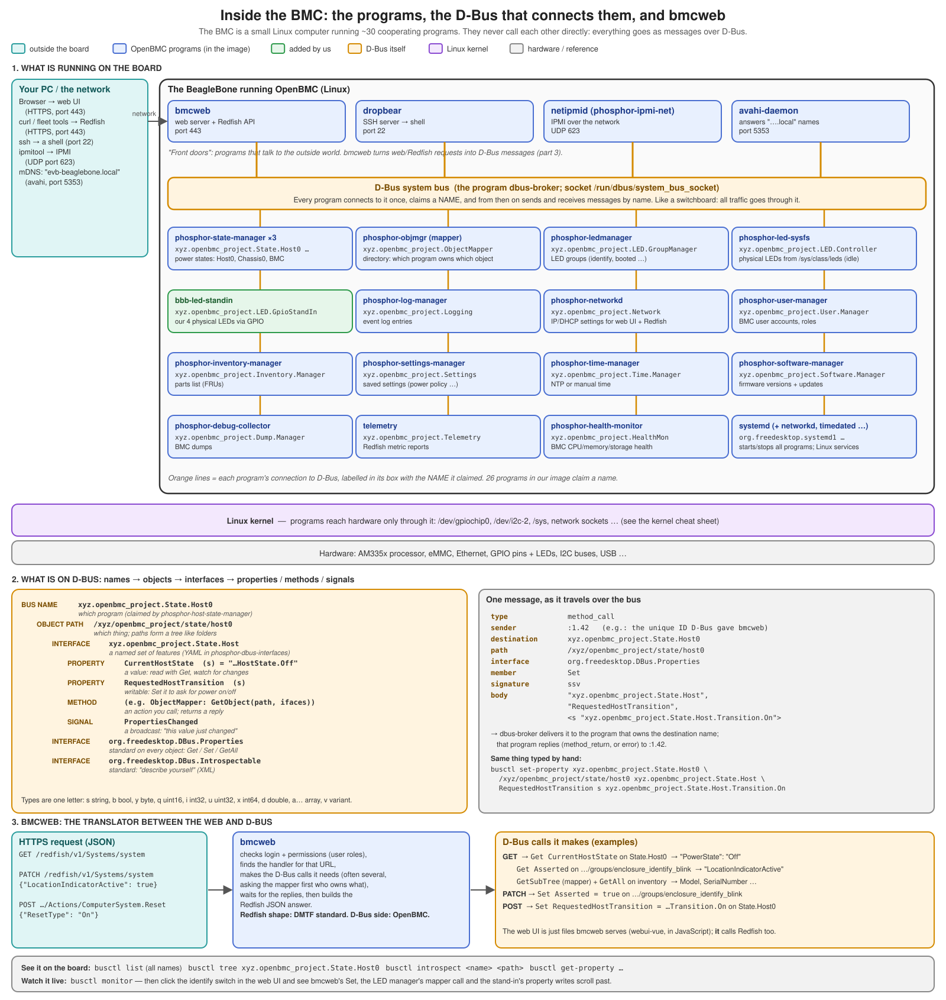
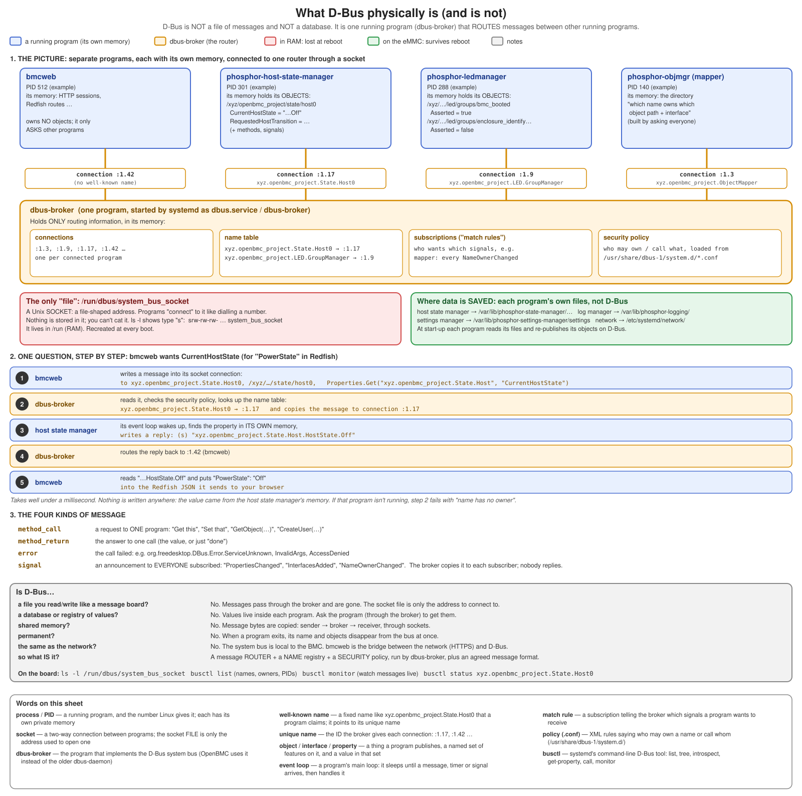
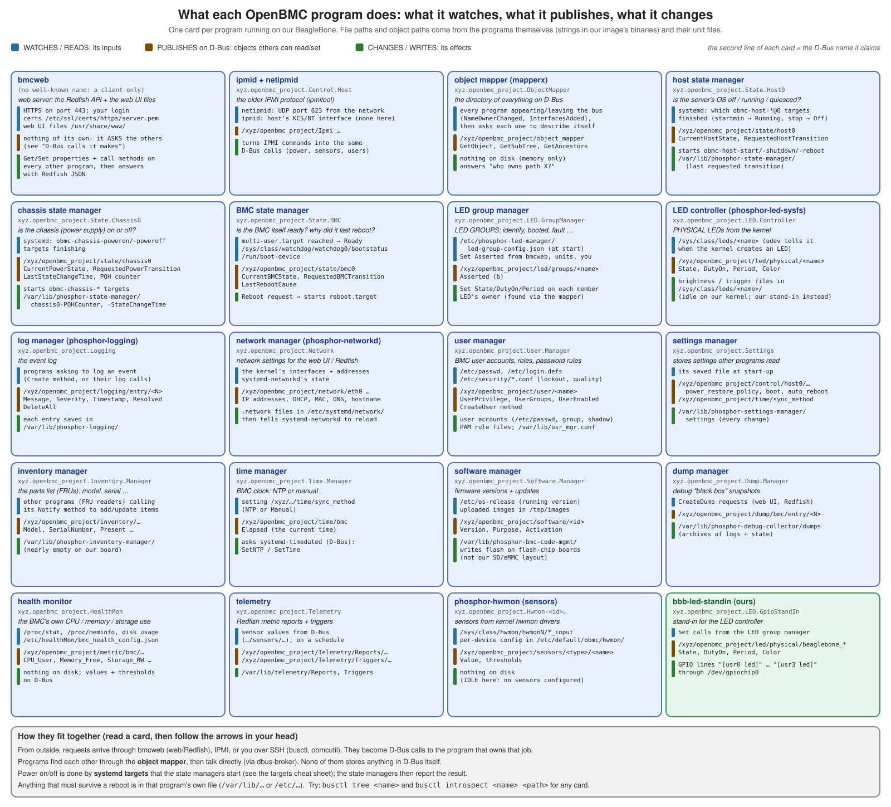
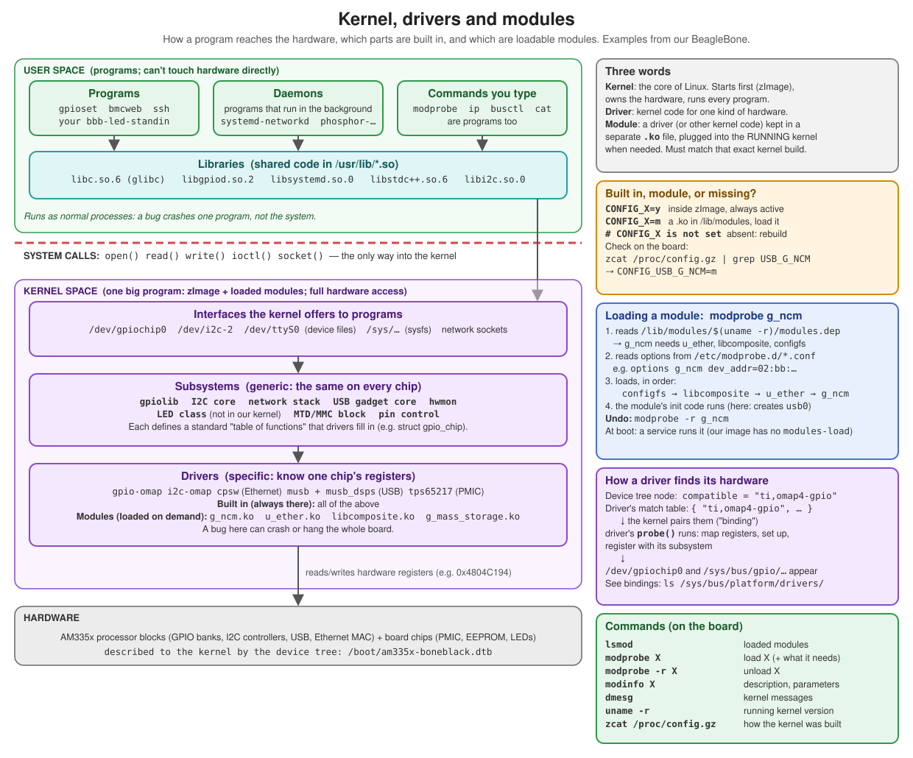
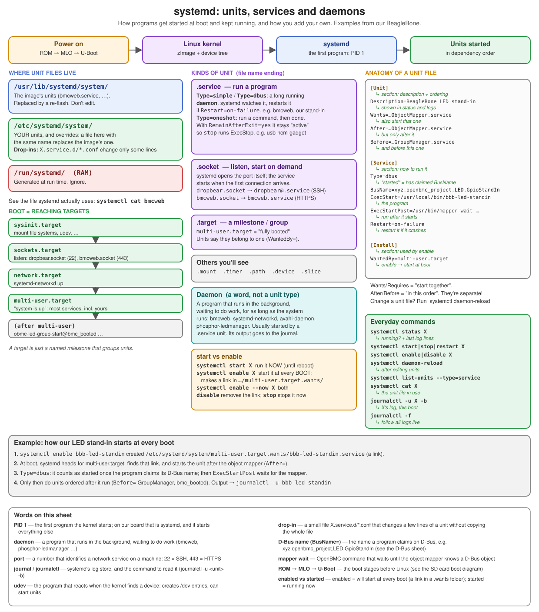
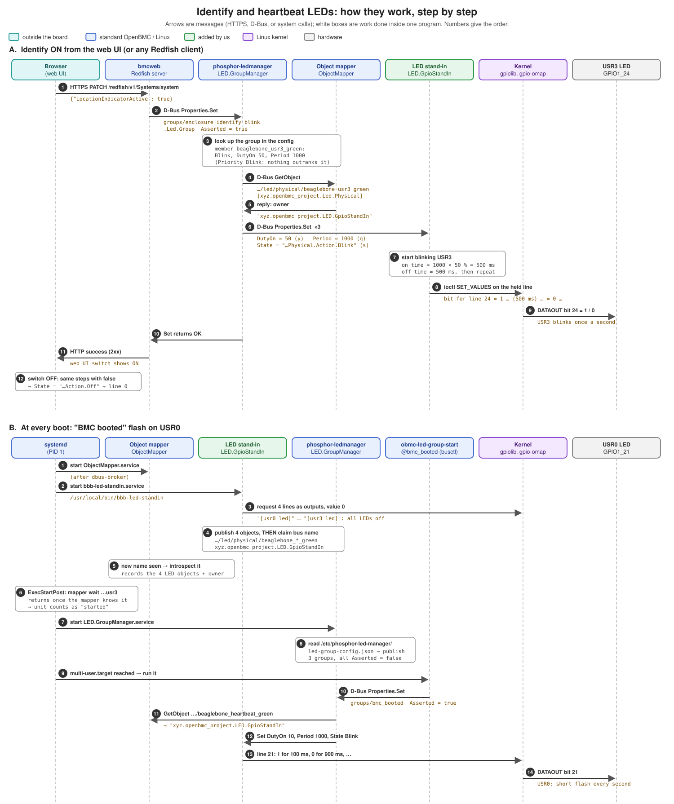
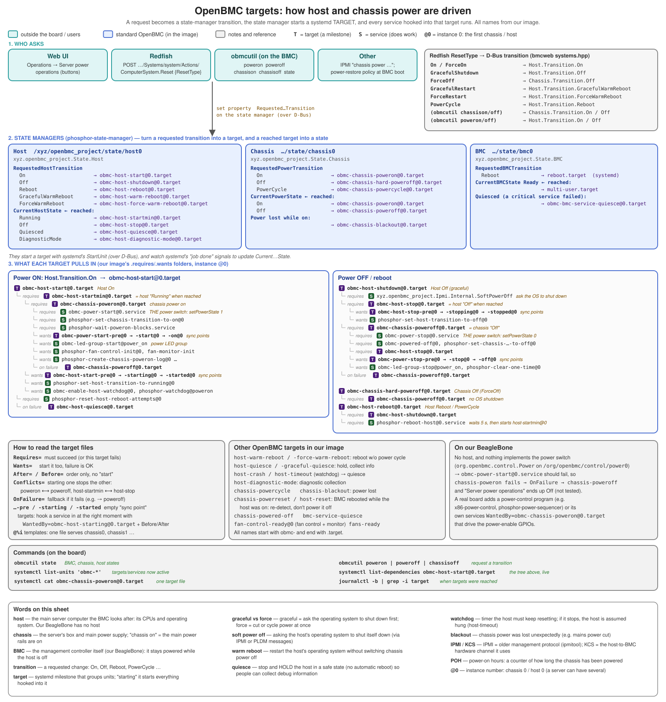

# Cheat sheets

One-page diagrams to keep open while you work on the board. Each uses real
examples from our BeagleBone OpenBMC image: folder names, programs and
commands as they are on the board.

Click an image to open it full size. They're SVG files, so they stay sharp
when you zoom in, and they print well.

## 0. Inside the BMC: programs, D-Bus and bmcweb (start here)

[`openbmc-inside.svg`](openbmc-inside.svg): **what the running BMC looks
like**:
1. The board's "front door" programs (bmcweb, SSH, IPMI, avahi) and their
   network ports.
2. The D-Bus system bus in the middle, with 16 of the OpenBMC programs
   plugged into it, each with the name it claims and what it does.
3. The kernel and hardware underneath.
4. What is *on* D-Bus: bus name → object path → interface → properties,
   methods and signals, with a real example (host power state).
5. What one message looks like as it travels over the bus.
6. bmcweb as the translator: a Redfish request becomes D-Bus calls, and their
   replies become the Redfish JSON answer.



## 0a. What D-Bus physically is (and is not)

[`dbus-explained.svg`](dbus-explained.svg): for anyone picturing D-Bus as a
file or a message board. It isn't one:
* **The picture:** separate programs, each holding its own objects in its
  own memory, connected through one socket to **dbus-broker**, a router that
  holds only connections, a name table, subscriptions and a security policy.
* **The only "file"**, `/run/dbus/system_bus_socket`, is just an address.
  Saved data lives in each program's own files.
* **One question followed step by step:** bmcweb asks for `CurrentHostState`.
* **The four kinds of message**, and a list of common misconceptions.



## 0b. What each OpenBMC program does

[`openbmc-programs.svg`](openbmc-programs.svg): **one card per program**
running on our BeagleBone. Each card gives its job and its D-Bus name, plus:
* what it **watches or reads**: its inputs, files and signals;
* what it **publishes** on D-Bus: its objects and properties;
* what it **changes or writes**: its effects, including files saved on the
  eMMC.

The programs covered: bmcweb, IPMI, the object mapper, the host / chassis /
BMC state managers, the LED group manager and LED controller (plus our
stand-in), logging, network, users, settings, inventory, time, software,
dump, health monitor, telemetry and hwmon. File and object paths come from
the programs themselves (strings in our image's binaries) and their unit
files.



## 1. Where things live in Linux

[`linux-folders.svg`](linux-folders.svg): every important folder:
* what lives there;
* whether it's part of the image, your own additions, in RAM, or made up by
  the kernel;
* what survives a reboot and what a re-flash replaces;
* the eMMC's partitions;
* rules of thumb such as "image = `/usr`, yours = `/etc`".


## 2. Kernel, drivers and modules

[`kernel-drivers-modules.svg`](kernel-drivers-modules.svg):
* the layers from a program down to the hardware, with system calls as the
  only way in;
* built-in drivers vs loadable modules (`=y` / `=m` / not set);
* what `modprobe g_ncm` does step by step;
* how a driver is matched to its hardware through the device tree;
* the commands to use.



## 3. systemd: units, services and daemons

[`systemd-units-services.svg`](systemd-units-services.svg):
* the boot chain up to systemd;
* where unit files live, and how `/etc` overrides the image;
* the kinds of unit (`.service`, `.socket`, `.target`);
* what a daemon is;
* `start` vs `enable`;
* an annotated unit file (our LED stand-in);
* everyday commands;
* how our stand-in starts at every boot.



## 4. USB: host, device and "gadget"

[`usb-gadget.svg`](usb-gadget.svg):
* which BeagleBone port is host and which is device;
* the PC's USB stack next to the board's gadget stack (for USB networking
  with `g_ncm`), joined by the cable;
* the standard USB device classes (NCM, ECM, RNDIS, ACM…);
* legacy gadget modules vs configfs;
* commands to look at it on the board.


## 5. GPIO toggle, layer by layer: C and C++

Two detailed diagrams of the example programs from
[`cross-compile-a-gpio-program.md`](../cross-compile-a-gpio-program.md) and
[`cross-compile-a-gpio-program_cpp.md`](../cross-compile-a-gpio-program_cpp.md).

**Rows are the layers**, from your code down to the LED:
* your code (Path A and Path B);
* libgpiod, and on the C++ sheet the C++ helpers;
* glibc;
* the system call;
* the kernel's GPIO character device, gpiolib and the `gpio-omap` driver;
* the GPIO registers;
* the pin.

**Columns are the four phases**:
1. find the line;
2. reserve it as an output;
3. toggle;
4. release.

Each cell names the real function, `ioctl` code, system call number or
register involved. The functions and codes come from libgpiod 1.6.5 and
Linux 6.18's source, and the request codes were printed by a program
compiled for the board.

* [`gpio-toggle-c-layers.svg`](gpio-toggle-c-layers.svg): `gpio-blink-uapi.c`
  and `gpio-blink-gpiod.c`.
* [`gpio-toggle-cpp-layers.svg`](gpio-toggle-cpp-layers.svg):
  `gpio-blink-uapi.cpp` and `gpio-blink-gpiod.cpp`. The user-space rows show
  what C++ adds: RAII, `std::optional`, exceptions, and libgpiodcxx's
  wrappers. Everything from the system call down is identical to C.


## 6. Identify and heartbeat LEDs: how they're set up and how they work

For the live LED setup in
[`hook-up-identify-and-heartbeat-leds_cpp.md`](../hook-up-identify-and-heartbeat-leds_cpp.md)
(and its [Rust version](../hook-up-identify-and-heartbeat-leds_rust.md)).

* [`leds-architecture.svg`](leds-architecture.svg): **every layer as a
  tree**:
  * who asks for an LED (web UI, Redfish clients, the boot-time `bmc_booted`
    unit, you);
  * bmcweb;
  * the D-Bus;
  * phosphor-ledmanager with its three groups and the JSON file;
  * the object mapper;
  * the stand-in with its four LED objects;
  * the kernel;
  * the four LEDs.

  The orange labels on the arrows are the exact "plugs": D-Bus names, object
  paths, properties, files. On the right:
  * which systemd unit starts what, and in what order;
  * the files we added to the board;
  * what changes after the image rebuild.
* [`leds-sequences.svg`](leds-sequences.svg): **step by step**, as two
  sequence diagrams:
  * **A.** turning identify on from the web UI: from the HTTPS request
    through the group, the mapper lookup and the property writes, down to the
    blinking pin;
  * **B.** what happens at every boot, ending with USR0's "BMC booted" flash.




## 7. OpenBMC targets: how host and chassis power are driven

[`openbmc-targets.svg`](openbmc-targets.svg): how a power request becomes
systemd activity, top to bottom:
1. **Who asks:** the web UI, Redfish `ComputerSystem.Reset` (with a table of
   each `ResetType` → D-Bus transition, from bmcweb's source), `obmcutil`,
   IPMI, and the power-restore policy.
2. **The state managers (Host, Chassis, BMC):** which target each requested
   transition starts, and which reached target sets each current state (from
   phosphor-state-manager's source at our image's version).
3. **The trees of what `obmc-host-start@0.target` (power on) and the power
   off and reboot targets pull in:** from our image's `.requires`/`.wants`
   folders, with targets and services marked, and the "sync point" chains
   (`-pre` → `-starting` → `-started`).
4. **Reference:**
   * how to read `Requires=` / `Wants=` / `Conflicts=` / `OnFailure=`;
   * the other OpenBMC targets;
   * what happens on our BeagleBone, which has nothing implementing the power
     switch;
   * commands.



---

## Changing them

The SVGs are generated by small Python scripts in [`src/`](src/), one per
sheet, plus `lib.py` with shared drawing helpers. That way the colours and
layout stay consistent. To change a sheet, edit its script and run, for
example:

```sh
cd beaglebone/cheatsheets/src
python3 folders.py . ../linux-folders.svg
```

The first argument is the folder containing `lib.py`; the second is the SVG
to write. They need only Python 3, with no extra packages.

| Script | Writes |
| --- | --- |
| `folders.py` | `linux-folders.svg` |
| `kernel.py` | `kernel-drivers-modules.svg` |
| `systemd.py` | `systemd-units-services.svg` |
| `usb.py` | `usb-gadget.svg` |
| `leds.py` | `leds-architecture.svg` and `leds-sequences.svg` (run as `python3 leds.py . ..`) |
| `inside.py` | `openbmc-inside.svg` (run as `python3 inside.py . ..`) |
| `dbus_programs.py` | `dbus-explained.svg` and `openbmc-programs.svg` (run as `python3 dbus_programs.py . ..`) |
| `targets.py` | `openbmc-targets.svg` (run as `python3 targets.py . ..`) |
| `gpio_flow.py` | `gpio-toggle-c-layers.svg` and `gpio-toggle-cpp-layers.svg` (run as `python3 gpio_flow.py . ..`) |
