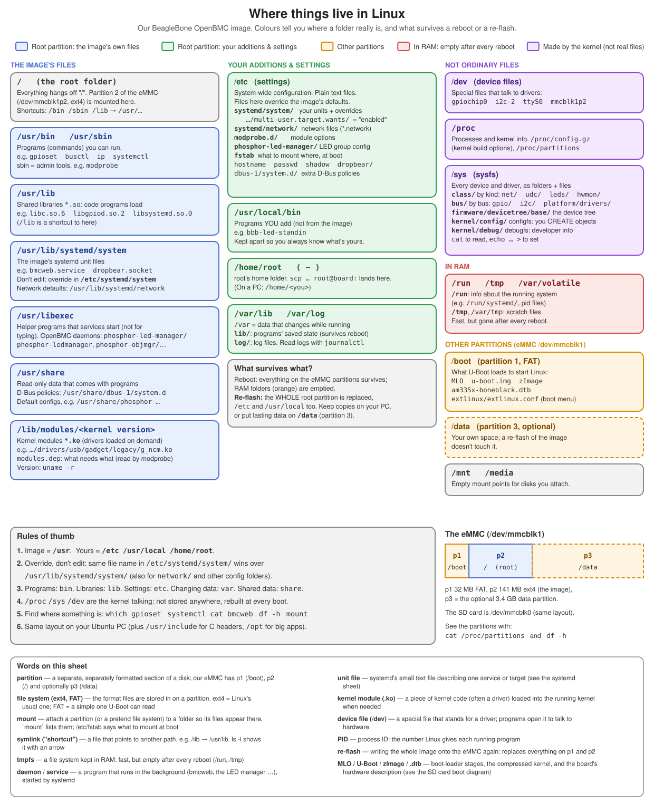

# Cheat sheets

One-page diagrams to keep open while you work on the board. Each uses real
examples from our BeagleBone OpenBMC image: folder names, programs and
commands as they are on the board.

Click an image to open it full size. They're SVG files, so they stay sharp
when you zoom in, and they print well.

## 1. Where things live in Linux

[`linux-folders.svg`](linux-folders.svg): every important folder:
* what lives there;
* whether it's part of the image, your own additions, in RAM, or made up by
  the kernel;
* what survives a reboot and what a re-flash replaces;
* the eMMC's partitions;
* rules of thumb such as "image = `/usr`, yours = `/etc`".



## 2. Kernel, drivers and modules

[`kernel-drivers-modules.svg`](kernel-drivers-modules.svg):
* the layers from a program down to the hardware, with system calls as the
  only way in;
* built-in drivers vs loadable modules (`=y` / `=m` / not set);
* what `modprobe g_ncm` does step by step;
* how a driver is matched to its hardware through the device tree;
* the commands to use.


## 3. systemd: units, services and daemons

[`systemd-units-services.svg`](systemd-units-services.svg):
* the boot chain up to systemd;
* where unit files live, and how `/etc` overrides the image;
* the kinds of unit (`.service`, `.socket`, `.target`);
* what a daemon is;
* `start` vs `enable`;
* an annotated unit file (our LED stand-in);
* everyday commands;
* how our stand-in starts at every boot.


## 4. USB: host, device and "gadget"

[`usb-gadget.svg`](usb-gadget.svg):
* which BeagleBone port is host and which is device;
* the PC's USB stack next to the board's gadget stack (for USB networking
  with `g_ncm`), joined by the cable;
* the standard USB device classes (NCM, ECM, RNDIS, ACM…);
* legacy gadget modules vs configfs;
* commands to look at it on the board.


---

## Changing them

The SVGs are generated by small Python scripts in [`src/`](src/), one per
sheet, plus `lib.py` with shared drawing helpers. That way the colours and
layout stay consistent. To change a sheet, edit its script and run, for
example:

```sh
cd beaglebone/cheatsheets/src
python3 folders.py . ../linux-folders.svg
```

The first argument is the folder containing `lib.py`; the second is the SVG
to write. They need only Python 3, with no extra packages.

| Script | Writes |
| --- | --- |
| `folders.py` | `linux-folders.svg` |
| `kernel.py` | `kernel-drivers-modules.svg` |
| `systemd.py` | `systemd-units-services.svg` |
| `usb.py` | `usb-gadget.svg` |
