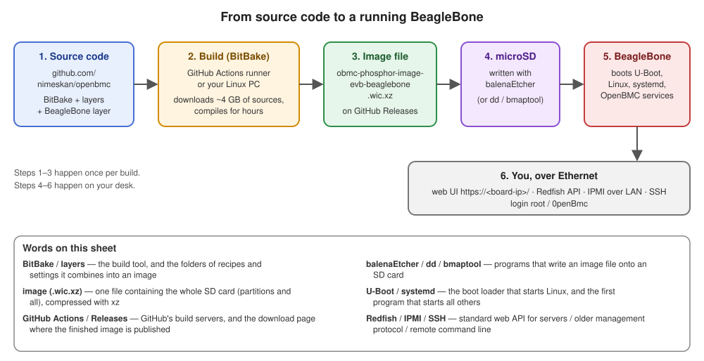
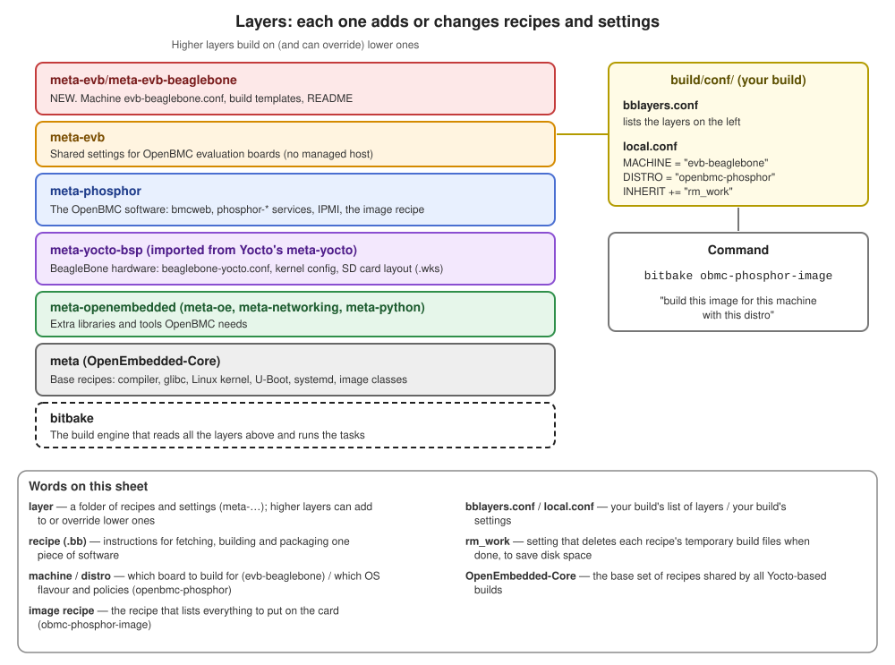
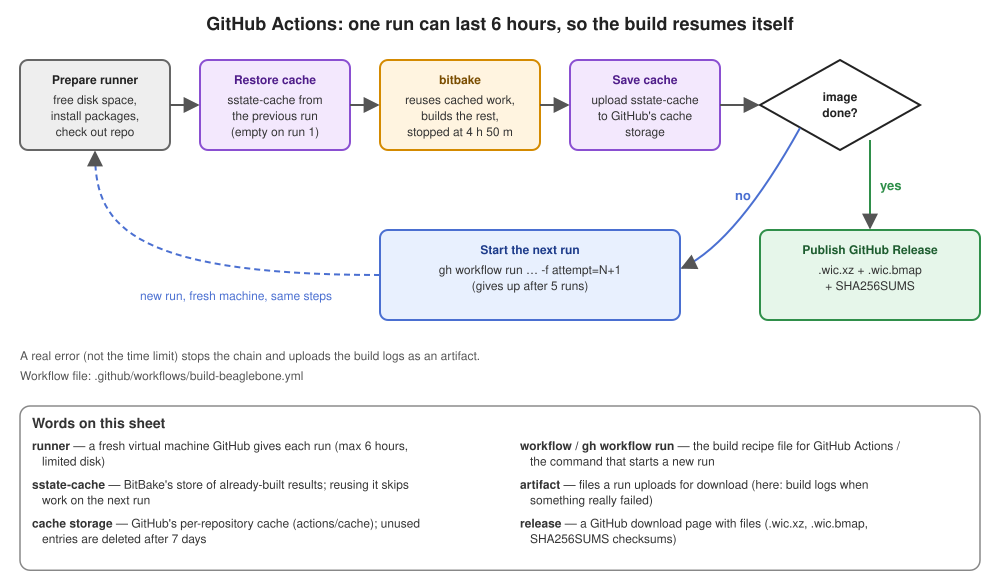
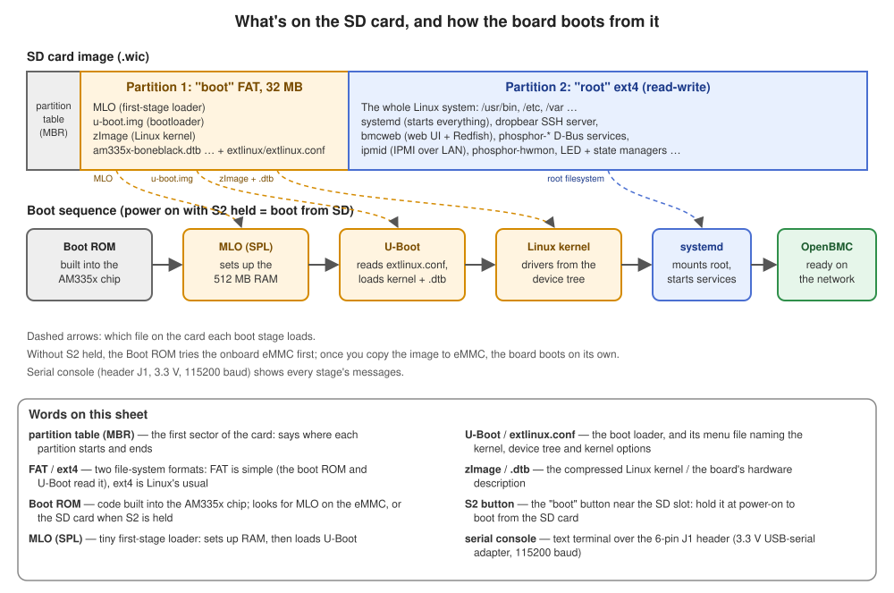

# Description of tools: how we get from source code to OpenBMC on the BeagleBone

This page explains every tool and piece involved, using **one analogy all the
way through: a professional restaurant kitchen** that prepares a packed meal
for one particular customer. Each section gives:

* 🍳 **The analogy:** what it's like in the kitchen.
* 🔧 **What it really is:** the technical meaning.
* 📍 **In our project:** where you find it in this repository or build.

The [main guide](README.md) has the full technical details; this page is for
building the mental picture first.

---

## The whole story in one paragraph

We want a small, custom Linux system (OpenBMC) to run on a small ARM computer
(the BeagleBone Black). Nobody sells that ready-made, so we **cook it from
scratch**. The **Yocto Project** is the kitchen system: rules and a huge
library of recipes. **BitBake** is the head chef who reads those recipes and
cooks everything in the right order. **Layers** are cookbooks stacked on the
shelf: a basic cookbook, an OpenBMC cookbook, a BeagleBone cookbook, and our
own small one. The **machine** setting says who the meal is for (the
BeagleBone), the **distro** says the house style (OpenBMC's), and the
**image** is the order: "one complete OpenBMC system, please". BitBake shops
for every ingredient (source code), cooks each dish (compiles each program) with
a special stove that cooks for a different kind of eater (a **cross-compiler**
for ARM), packs everything into a lunchbox (the **root filesystem**), and seals
the lunchbox into a delivery box (the **SD card image**). The cooking happened
in a rented kitchen (**GitHub Actions**), and the finished box sits at the
pickup counter (**GitHub Releases**). You copy it onto an SD card, and the
BeagleBone "eats" it at power-on: a relay of small programs (**MLO, U-Boot,
Linux, systemd**) wakes the board up and starts OpenBMC.

---

## Part 1: What we're making

### Linux and "embedded Linux"

* 🍳 A **meal**. A desktop Linux like Ubuntu is a huge all-you-can-eat
  buffet: everything for everyone. **Embedded Linux** is a single packed meal,
  cooked for one person, containing only what they need.
* 🔧 Linux is an operating system. Embedded Linux is a Linux system built for
  one specific device, containing only what that device needs. You don't
  install it like Ubuntu; you build it on a big computer and copy the result
  onto the device.
* 📍 Our meal is about 173 MB in total. Ubuntu Desktop is many gigabytes.

### OpenBMC

* 🍳 The **menu**: the specific dishes the customer ordered. A web server
  dish, a user-accounts dish, a sensors dish, a logging dish…
* 🔧 Open-source firmware for a **BMC** (Baseboard Management Controller): the
  small computer on a server's motherboard that lets you manage the server
  over the network. OpenBMC is Linux plus a set of programs that do the
  management work: `bmcweb` (web UI and Redfish), user management, logging,
  sensors, and so on.
* 📍 The official code comes from <https://github.com/openbmc/openbmc>. Our
  repository is a copy of it plus our BeagleBone additions. OpenBMC's own
  recipes live in `meta-phosphor/`.

### The BeagleBone Black

* 🍳 The **customer**, with their own particular needs: a small appetite
  (512 MB of memory), and they eat with chopsticks, not a fork (an **ARM**
  processor, not the **x86** processor in your PC).
* 🔧 A small single-board computer with a TI AM335x ARM processor, 512 MB RAM,
  4 GB eMMC storage, a microSD slot and Ethernet. It isn't a real server BMC
  chip, but it can run the same software.
* 📍 Everything we build is "for the BeagleBone": that's why it's called the
  **target** (who eats), while the PC that builds is the **host** (who cooks).

---

## Part 2: The kitchen system

### The Yocto Project

* 🍳 The **whole professional kitchen system**: the kitchen rules, the
  techniques, the standard way of writing recipes, and a huge library of
  recipes everyone shares. It doesn't cook anything by itself.
* 🔧 A set of tools and conventions for building custom embedded Linux
  systems from source code. Most of the embedded Linux world uses it, including
  OpenBMC. (The name: "yocto" is a metric prefix for a tiny amount,
  10⁻²⁴, a nod to small systems.)
* 📍 Docs: <https://docs.yoctoproject.org/>. You don't install "Yocto";
  you use its parts below.

### OpenEmbedded-Core ("oe-core")

* 🍳 The **basic cookbook** every kitchen starts with: recipes for bread,
  stock, sauces. The basics every meal needs.
* 🔧 The core set of recipes and build rules: the compiler, the C library,
  the Linux kernel, U-Boot, systemd, and the rules for making images.
* 📍 `upstream-layers/openembedded-core/`, which shows up at the top of the
  repository as `meta`.

### BitBake

* 🍳 The **head chef**. Hand them an order ("one OpenBMC system for the
  BeagleBone") and they read every cookbook on the shelf, work out every dish
  and sub-dish needed (to make the sauce you first need the stock…), put them in
  the right order, and keep a whole brigade of cooks busy at once, one per
  stove (one per CPU core).
* 🔧 The build engine. You run `bitbake obmc-phosphor-image`. It reads all the
  layers and recipes, works out the dependencies, and runs the build **tasks**
  (download, unpack, patch, configure, compile, install, package), many in
  parallel. Written in Python.
* 📍 `upstream-layers/bitbake/` (shown as `bitbake`). For our image BitBake ran
  **6,296 tasks**.

### Recipes (`.bb` files)

* 🍳 **One recipe card per dish**: where to buy the ingredients, how to prepare
  them, how to cook, how to portion.
* 🔧 A file describing how to build one piece of software: where to download
  its source code (`SRC_URI`), which patches to apply, and how to configure,
  compile and install it.
* 📍 Thousands of them. Examples: `meta-phosphor/recipes-phosphor/interfaces/bmcweb_git.bb`
  (the web server), `meta/recipes-kernel/linux/linux-yocto_6.18.bb` (the kernel).

### Append files (`.bbappend`)

* 🍳 A **sticky note on someone else's recipe card**: "for this customer, add
  less salt". You change the recipe without rewriting the original card.
* 🔧 Changes to an existing recipe, kept in a different layer.
* 📍 Example: `meta-yocto-bsp` has a `linux-yocto` append saying "this kernel
  also supports the BeagleBone".

### Layers (`meta-…` folders)

* 🍳 **Cookbooks stacked on the shelf.** A basic cookbook, a speciality
  cookbook, a cookbook for one customer's diet, your own notebook. Higher ones
  can override lower ones.
* 🔧 Folders of recipes and settings on one topic. A build uses a stack of them.
* 📍 Our stack, top to bottom:

| Cookbook | Layer | What it adds |
| --- | --- | --- |
| Our own notebook | `meta-evb/meta-evb-beaglebone` | The BeagleBone machine for OpenBMC (6 small files we wrote) |
| Notes for "demo customers" | `meta-evb` | OpenBMC settings for evaluation boards |
| The OpenBMC speciality cookbook | `meta-phosphor` | All of OpenBMC's programs |
| The BeagleBone diet book | `meta-yocto-bsp` | Kernel, U-Boot and SD-card layout for the BeagleBone (copied from Yocto) |
| Extra side dishes | `meta-openembedded` (`meta-oe`, `meta-networking`, `meta-python`) | Extra libraries and tools OpenBMC needs |
| The basic cookbook | `meta` (OpenEmbedded-Core) | The basics |
| The head chef | `bitbake` | Not a cookbook: the one who reads them all |

### Machine configuration

* 🍳 The **customer card**: who's eating, and their needs. "Eats with
  chopsticks (ARM Cortex-A8), small appetite, needs the box shaped to fit their
  lunch bag (SD card layout)."
* 🔧 A `.conf` file describing the hardware: CPU type, kernel, bootloader,
  device tree, image format.
* 📍 `meta-evb/meta-evb-beaglebone/conf/machine/evb-beaglebone.conf`. It mostly
  says "start from Yocto's BeagleBone card (`beaglebone-yocto.conf`), add
  OpenBMC's evaluation-board notes, and pack it as an SD card image (`wic.xz`)".

### Distro configuration

* 🍳 The **house style** of the restaurant: "we always use olive oil, always
  serve with bread". The same style whatever the customer.
* 🔧 Policy for the whole system: which init system (systemd), which features,
  default settings, default passwords.
* 📍 `openbmc-phosphor`, OpenBMC's distro, defined in `meta-phosphor`.

### The image recipe

* 🍳 The **order ticket**: "one complete OpenBMC meal". It lists every dish
  that goes in the box.
* 🔧 A special recipe that lists the packages to put into the final system,
  instead of building one program.
* 📍 `obmc-phosphor-image`, which is why the command is
  `bitbake obmc-phosphor-image`.

### `local.conf` and `bblayers.conf`

* 🍳 **Today's ticket pinned above the stove** (`local.conf`: which customer,
  which house style, "wash dishes as you go") and **which cookbooks are on the
  shelf today** (`bblayers.conf`).
* 🔧 The two settings files in your **build directory**.
* 📍 Copied from our templates in `meta-evb/meta-evb-beaglebone/conf/templates/default/`:
  `MACHINE = "evb-beaglebone"`, `DISTRO = "openbmc-phosphor"`,
  `INHERIT += "rm_work"`.

### `oe-init-build-env` and `setup`

* 🍳 **Setting up your workstation** before cooking: apron on, ticket pinned,
  cookbooks on the shelf.
* 🔧 Scripts you "source" (`. ./oe-init-build-env build-dir`) to create the
  build directory from the templates and make `bitbake` available in your
  terminal. OpenBMC's `setup` script (`. setup evb-beaglebone`) does the same,
  picking the right templates for a machine.

---

## Part 3: Cooking

### Host packages (the build tools on your PC)

* 🍳 The **kitchen appliances**: stoves, knives, mixers. You need them before
  you can follow any recipe.
* 🔧 Programs the build computer needs: `gcc`, `make`, `git`, `python3`,
  `chrpath`, `diffstat` and others, installed with `apt`.
* 📍 Listed and explained in [build-beaglebone.sh](build-beaglebone.sh), step 2.

### Fetching and the `downloads/` folder

* 🍳 **Grocery shopping.** The recipe cards say where to buy each ingredient;
  the chef sends someone shopping and keeps everything in the **pantry**.
* 🔧 BitBake downloads each recipe's source code (archives or git
  repositories) into `downloads/`. Several GB for this build (3.3 GB when our
  first, unfinished attempt stopped). Kept for next time.

### The cross-compiler (toolchain)

* 🍳 A **special stove that cooks for chopstick eaters.** Your kitchen normally
  makes meals for fork users (x86 PCs). To feed the customer, the chef first
  **builds a special stove**, then uses it for every dish.
* 🔧 A compiler that runs on your x86 PC but produces programs for the
  BeagleBone's ARM processor. BitBake builds this toolchain itself, from source,
  before anything else. That's one reason a first build takes hours.
* 📍 Built as `gcc-cross-arm` and friends; the BeagleBone's packages are built
  in `tmp/work/cortexa8t2hf-neon-…/`.

### `-native` recipes

* 🍳 **Tools for the kitchen itself**: knives you sharpen, a new mixer you
  assemble. They help cook but aren't served to the customer.
* 🔧 Programs built to run on the build PC during the build (`cmake-native`,
  `rust-native`, …), not on the BeagleBone.
* 📍 `tmp/work/x86_64-linux/`. The Rust toolchain alone (`rust-native` and
  `cargo-native`) took about 10 GB there, a big part of what filled the first
  cloud session's disk.

### Tasks

* 🍳 **The steps of each recipe**: shop, unpack, wash, chop, cook, portion,
  clean up. The head chef tracks each step of each dish.
* 🔧 `do_fetch`, `do_unpack`, `do_patch`, `do_configure`, `do_compile`,
  `do_install`, `do_package`, `do_rm_work`, and so on.

### The sstate cache (`sstate-cache/`)

* 🍳 The **freezer of prepared components.** Every time a dish component is
  done, a portion goes in the freezer, labelled with exactly how it was made.
  Next time, if the recipe and ingredients haven't changed, the chef takes it
  out instead of cooking again.
* 🔧 BitBake saves the output of finished tasks, labelled with a fingerprint
  (hash) of all their inputs. If nothing changed, it reuses them.
* 📍 Why our **run 3 took 7 minutes instead of 9 hours**: it pulled everything
  from run 2's freezer.

### `rm_work`

* 🍳 **Washing up as you go**, so the kitchen counters don't overflow.
* 🔧 Deletes each recipe's work folder once that recipe is finished.
* 📍 Turned on in our `local.conf`. It saves a lot of disk space, though even
  with it the build needs tens of GB.

### Packages (`.ipk` files)

* 🍳 **Portioned, labelled containers** of each finished dish.
* 🔧 Each recipe's results, split into installable packages (the program,
  its documentation, its debug info…).
* 📍 `tmp/deploy/ipk/`.

### The root filesystem (rootfs)

* 🍳 **Packing the lunchbox**: the chosen containers go into one box.
* 🔧 All the files of the running system (`/usr`, `/etc`, `/var`…),
  assembled by installing the image's packages into an empty folder.
* 📍 Becomes the 141 MB `root` partition on the SD card.

### `wic` and the `.wks` file

* 🍳 **Packing the lunchbox into a delivery box with compartments**, following
  a **box diagram**: "small compartment on the left for the starter
  instructions, big compartment for the meal."
* 🔧 `wic` is Yocto's tool for making a complete, partitioned disk image (an
  exact copy of an SD card). The `.wks` file (kickstart) describes the
  partitions.
* 📍 `meta-yocto-bsp/files/wic/beaglebone-yocto.wks`: a 32 MB `boot` partition and
  a `root` partition.

### The `.wic.xz` image

* 🍳 The **vacuum-sealed delivery box**, ready to ship.
* 🔧 The finished disk image (`.wic`), compressed with xz (`.xz`): 39.6 MB to
  download, 173 MB unpacked.
* 📍 `obmc-phosphor-image-evb-beaglebone.wic.xz`, plus `.wic.bmap` (a map of
  which parts of the box are actually filled, so writing it is faster).

---

## Part 4: Where the cooking happened

### Git and GitHub

* 🍳 **Git** is the kitchen's **recipe history book**: every change to every
  recipe is recorded, with who made it and why, so you can always go back.
  **GitHub** is the **library** where that book is kept online.
* 🔧 Git tracks changes to files over time (commits). GitHub hosts git
  repositories.
* 📍 `github.com/nimeskan/openbmc`. It holds OpenBMC's full history plus our
  commits on top.

### "Upstream"

* 🍳 The **original restaurant** whose recipe library we copied. They keep
  improving their recipes; we can copy their newer pages later.
* 🔧 The original project a copy is based on.
* 📍 `github.com/openbmc/openbmc`. We started from its commit `56e79ce3` and
  added our commits on top. We didn't modify any of its files.

### GitHub Actions (the cloud build)

* 🍳 A **rented commercial kitchen**. You don't own a big enough kitchen (your
  PC isn't Linux, and the cloud session's disk was too small), so you rent one.
  The rental is limited to **6 hours per booking**, so before time runs out the
  cook puts everything prepared so far in the **freezer**, books the kitchen
  again, and continues.
* 🔧 GitHub's service for running scripts (workflows) on its computers
  (runners). Each run may last up to 6 hours, so ours saves the sstate cache
  and starts the next run automatically.
* 📍 `.github/workflows/build-beaglebone.yml`. It took 3 runs; see
  [README section 7](README.md#7-the-cloud-build-github-actions).

### GitHub Releases

* 🍳 The **pickup counter**, where the finished, sealed boxes wait with a label.
* 🔧 A place on GitHub to publish downloadable files for a version.
* 📍 [Release `beaglebone-20261004-0244`](https://github.com/nimeskan/openbmc/releases/tag/beaglebone-20261004-0244).

### `build-beaglebone.sh`

* 🍳 A **checklist for cooking it in your own kitchen** later: check the
  appliances, buy the missing ones, set up the workstation, cook, box it.
* 🔧 Our script that does the same build on your own Ubuntu PC.
* 📍 [build-beaglebone.sh](build-beaglebone.sh).

---

## Part 5: Delivery and eating

### Flashing tools: balenaEtcher, `bmaptool`, `dd`

* 🍳 **Transferring the meal into the customer's own lunchbag** (the SD card),
  exactly as packed. Etcher is a friendly helper; `bmaptool` is a careful
  helper who skips empty compartments and checks each one; `dd` is a strong
  helper who copies every byte without asking, even onto the wrong bag.
* 🔧 Programs that write the image byte-for-byte onto a card.
* 📍 [flashing-the-sd-card-on-ubuntu.md](flashing-the-sd-card-on-ubuntu.md);
  balenaEtcher in [README section 9](README.md#9-flash-and-boot).

### SD card and eMMC

* 🍳 Two places to keep the meal: a **lunchbag you can swap** (the microSD
  card) and the customer's **built-in fridge** (the 4 GB eMMC chip soldered on
  the board).
* 🔧 Two kinds of storage the BeagleBone can start from. Holding the **S2**
  button at power-on tells it to use the SD card.

### Booting: Boot ROM → MLO → U-Boot → Linux → systemd

* 🍳 **Opening a building in the morning, as a relay.** The security guard
  (Boot ROM, built into the chip) unlocks the front door and wakes the
  caretaker (**MLO**). The caretaker turns on the power and lights (sets up the
  memory) and calls the manager (**U-Boot**). The manager reads the day plan
  (`extlinux.conf`), takes out the building map (**device tree**) and calls
  the director (**Linux kernel**). The director opens every department and
  hands over to the floor supervisor (**systemd**), who starts every team
  (the OpenBMC services) and keeps them running.
* 🔧
  * **Boot ROM:** tiny program inside the processor; finds the next stage.
  * **MLO (SPL):** first-stage loader; sets up the RAM.
  * **U-Boot:** the bootloader; loads the kernel and device tree.
  * **Device tree (`am335x-boneblack.dtb`):** description of the board's
    hardware, read by the kernel.
  * **Linux kernel (`zImage`):** the core of the operating system; drivers for
    the hardware.
  * **systemd:** the first program; starts and supervises all others.
* 📍 All on the SD card's `boot` partition (MLO, `u-boot.img`, `zImage`,
  `.dtb` files, `extlinux/extlinux.conf`).

### The serial console

* 🍳 A **walkie-talkie into the kitchen** that works even when the phones
  (the network) are down. You hear every announcement from the moment the
  building opens.
* 🔧 The board's debug UART on header J1, reached with a 3.3 V USB-serial cable.
* 📍 [Windows guide](connecting-from-a-windows-pc.md#a-serial-terminal-no-network-at-all),
  [Ubuntu guide](connecting-from-an-ubuntu-pc.md#a-serial-terminal-no-network-at-all).

---

## Part 6: OpenBMC running

### D-Bus

* 🍳 The **restaurant's notice board.** Every team pins up what it knows
  ("table 4's temperature is 25 °C"); others read it or get notified when
  something changes. Teams never call each other directly.
* 🔧 A message system; every OpenBMC program publishes its data as "objects"
  on it.

### bmcweb and Redfish

* 🍳 The **front-of-house waiter.** Guests (you, your browser, scripts) never
  enter the kitchen. They ask the waiter, who reads the notice board and
  brings back the answer on a standard menu card (**Redfish**, JSON).
* 🔧 `bmcweb` is OpenBMC's web server; Redfish is the standard web API for
  managing servers. The web UI is a JavaScript app that talks to Redfish.
* 📍 [Redfish and I2C sensor guide](redfish-i2c-sensor/README.md).

### Sensor programs (entity-manager, dbus-sensors, phosphor-hwmon)

* 🍳 **Staff who check the thermometers** and pin the readings on the board.
  There are two staffing models: an older one and a newer one.
* 🔧 Programs that read sensor chips and publish them on D-Bus. Our image uses
  OpenBMC's default (older) one and has no sensors configured.
* 📍 [Sensor guide, section 4](redfish-i2c-sensor/README.md#4-how-sensors-work-in-openbmc).

---

## Cheat sheet

| Kitchen | Real thing | Where in our project |
| --- | --- | --- |
| The meal | Embedded Linux system | The image |
| The menu | OpenBMC | `meta-phosphor/` |
| The customer (eats with chopsticks) | BeagleBone Black (ARM) | `evb-beaglebone` machine |
| Kitchen system | Yocto Project | (the whole method) |
| Basic cookbook | OpenEmbedded-Core | `meta` |
| Head chef | BitBake | `bitbake` |
| Recipe card | Recipe (`.bb`) | e.g. `bmcweb_git.bb` |
| Sticky note on a recipe | `.bbappend` | e.g. the kernel append in `meta-yocto-bsp` |
| Cookbooks on the shelf | Layers | `bblayers.conf` |
| Customer card | Machine config | `evb-beaglebone.conf` |
| House style | Distro | `openbmc-phosphor` |
| Order ticket | Image recipe | `obmc-phosphor-image` |
| Today's ticket | `local.conf` | build directory `conf/` |
| Kitchen appliances | Host packages | `apt install …` (script step 2) |
| Pantry | `downloads/` | build directory |
| Special stove for chopstick eaters | Cross-compiler | `gcc-cross-arm` |
| Kitchen tools (not served) | `-native` recipes | `tmp/work/x86_64-linux/` |
| Freezer of prepared components | sstate cache | `sstate-cache/` |
| Washing up as you go | `rm_work` | `local.conf` |
| Portioned containers | Packages (`.ipk`) | `tmp/deploy/ipk/` |
| Packed lunchbox | Root filesystem | `root` partition |
| Box diagram | `.wks` file | `beaglebone-yocto.wks` |
| Vacuum-sealed box | `.wic.xz` image | the Release download |
| Recipe history book / library | Git / GitHub | `nimeskan/openbmc` |
| Original restaurant | Upstream | `openbmc/openbmc` |
| Rented kitchen (6-hour bookings) | GitHub Actions | `.github/workflows/build-beaglebone.yml` |
| Pickup counter | GitHub Releases | `beaglebone-20261004-0244` |
| Copying into the lunchbag | Flashing (Etcher / `bmaptool` / `dd`) | Flashing guide |
| Guard → caretaker → manager → director → supervisor | Boot ROM → MLO → U-Boot → Linux → systemd | SD card `boot` partition |
| Walkie-talkie | Serial console (J1) | Connection guides |
| Notice board | D-Bus | on the running board |
| Waiter / menu card | bmcweb / Redfish | `https://<board>/redfish/v1` |
